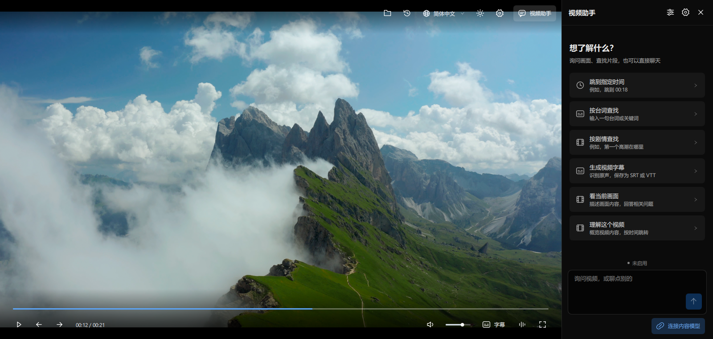
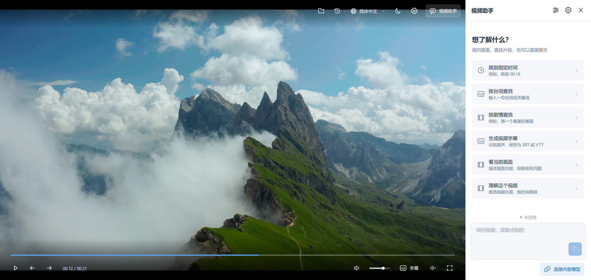

<p align="center">
  
</p>

<h1 align="center">PomiPlayer</h1>

<p align="center">A Windows video player with a video assistant you can talk to.</p>

<p align="center">
  <a href="https://github.com/Pumnn1ayLee/PomiPlayer/releases/download/v0.1.0-preview/PomiPlayer-0.1.0-Setup-x64.exe">Download for Windows</a>　
  <a href="docs/USAGE.en.md">User guide</a>　
  <a href="https://github.com/Pumnn1ayLee/PomiPlayer/issues/new/choose">Report an issue</a>　
  <a href="README.md">简体中文</a>
</p>

## Assets

**0.1.0 Preview for Windows x64, about 121 MB.** Currently tested on Windows 11.

[**PomiPlayer-0.1.0-Setup-x64.exe**](https://github.com/Pumnn1ayLee/PomiPlayer/releases/download/v0.1.0-preview/PomiPlayer-0.1.0-Setup-x64.exe)　
[Release notes](https://github.com/Pumnn1ayLee/PomiPlayer/releases/tag/v0.1.0-preview)

Choose a writable installation folder and run the installer. No administrator access is needed. Settings and caches stay in the player folder and survive uninstallation. This preview is not signed yet, so Windows may display a publisher warning.



PomiPlayer gives most of the window to your video. The assistant folds away, and playback controls hide when you are watching. It supports light and dark themes, subtitles, audio tracks, playback speed and custom shortcuts. You can also find a scene by asking for it.

## Ask about what you are watching

Open the assistant to find dialogue, ask about a frame, summarize a video, or talk about something else.

```text
Jump to 00:18
Find the scene with “signal”
What is on screen right now?
Summarize this video with key moments and timestamps
```

Video overviews put scenes in time order with buttons that take you to each one. Frame analysis uses samples, so it can miss brief actions.

Timestamp navigation and subtitle keyword search work without AI. Content questions need a model service configured in Settings. Local inference needs a runtime and model you provide. Cloud frame questions also require image support and separate permission to send sampled frames. The standard installer includes no model weights or API key.

## Subtitles

Ask to generate subtitles, choose SRT or VTT, then pick a save location. The default is the video's folder. Finished subtitles load automatically and can be searched in the assistant. Transcription requires a compatible Whisper GGML speech model.

## Make it yours

The context menu has playback speed, aspect ratio, audio and subtitle controls, frame stepping and screenshots. After a video ends, press Space or Play to start again.

Settings include shortcuts, subtitle styling and assistant parameters. Interface languages are Simplified Chinese, Traditional Chinese, English, Japanese, Korean, French, German, Spanish and Brazilian Portuguese. Switching needs no restart, and new answers follow the selected language.



See the [user guide](docs/USAGE.en.md) for details. The mountain footage is by Zlatin Georgiev on Pexels; see [media credits](docs/MEDIA_CREDITS.md).

## Feedback

This is an early preview. Please report problems in [Issues](https://github.com/Pumnn1ayLee/PomiPlayer/issues/new/choose), with the version, reproduction steps and relevant system information. Remove keys and private content from logs and screenshots. Use [private reporting](https://github.com/Pumnn1ayLee/PomiPlayer/security/advisories/new) for security vulnerabilities.

This repository hosts releases and feedback. PomiPlayer's core source is not public. See the [privacy policy (Chinese)](docs/PRIVACY.md) for data handling. Third-party components retain their own licenses; see [third-party information](docs/THIRD_PARTY.md) and [NOTICE](NOTICE.md).
