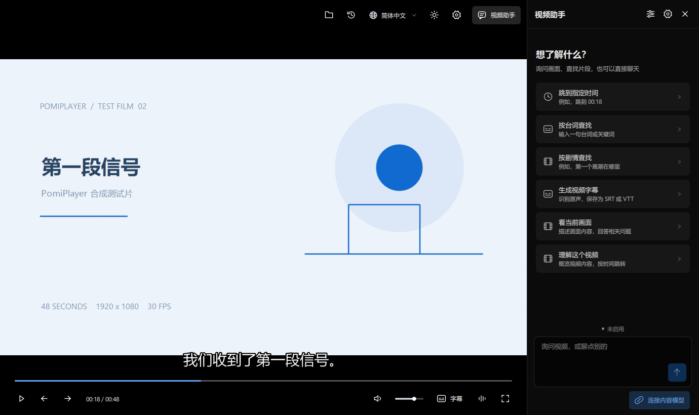
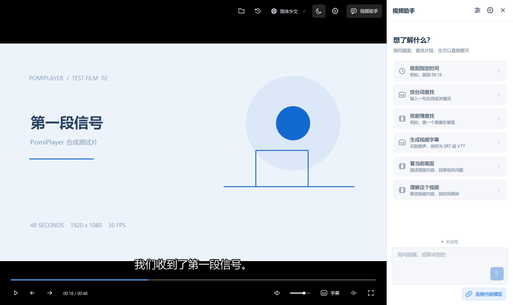

  

<h1 align="center">PomiPlayer</h1>

A Windows video player with an optional video assistant.

  <a href="https://github.com/Pumnn1ayLee/PomiPlayer/releases">Releases</a>　
  <a href="docs/USAGE.en.md">User guide</a>　
  <a href="https://github.com/Pumnn1ayLee/PomiPlayer/issues/new/choose">Report an issue</a>　
  <a href="README.md">简体中文</a>

PomiPlayer keeps the video at the center of the experience. Playback controls appear when needed, the assistant folds away, and the interface offers a restrained blue-and-white theme and a near-black dark theme.

Watch local videos, find dialogue, explore scenes, generate subtitles, or ask a question unrelated to the video.

## Release status

**0.1.0 preview. The first public release is being prepared.** There is no public installer download yet. The installer and SHA-256 checksums will be available in [Releases](https://github.com/Pumnn1ayLee/PomiPlayer/releases) after third-party distribution materials have been checked.

This is a product, release and feedback repository. **It does not contain PomiPlayer's application source code and is not an open-source project.** See [NOTICE](NOTICE.md) for rights information. Third-party components retain their own licenses.

## Features

| Feature | What it offers |
| --- | --- |
| Video playback | Local files, drag and drop, speed controls, audio and subtitle selection, aspect ratio, fullscreen, frame stepping and replay after playback ends. |
| Find a scene | Jump to a timestamp or search subtitle phrases. Connect a model service for questions about the video's content. |
| Video questions | Use available subtitles or authorized sampled frames. Video overviews organize scenes chronologically with clickable timestamps. |
| Subtitle generation | Choose SRT or VTT and a destination before transcription. Saved subtitles load automatically. A compatible speech model is required. |
| Optional AI | Connect your own cloud service, or provide a local runtime and model. Ordinary playback needs neither an AI model nor an account. |
| Interface | Light and dark themes, customizable shortcuts, a compact context menu and nine interface languages with live switching. |

Try a timestamp such as `00:18`, ask what is visible in the current frame, request a chronological overview, or start a general conversation. Time and playback commands do not require AI. Subtitle search needs subtitles; content questions and transcription need the relevant models or services.

New answers default to the interface language. An explicit request for another output language takes precedence. Image understanding requires an image-capable model and permission to send sampled frames.

## Getting started

Once the first public installer is available:

1. Download the Windows x64 installer and checksum from [Releases](https://github.com/Pumnn1ayLee/PomiPlayer/releases).
2. Choose a writable folder, such as `D:\Apps\PomiPlayer`. Administrator access is not required. Settings and caches stay inside the player folder.
3. Open a video. Configure a model service only if you want content questions, or select a speech model for subtitle transcription.

The standard installer includes no model weights, cloud account or API key. GPU inference components are separate from the standard package; consult the release notes for availability. Uninstallation preserves personal settings, caches and models you added.

The currently validated platform is **Windows 11 x64**. Local AI resource requirements depend on the model, context and image budget. Other Windows versions and ARM64 are outside the current validation scope.

See the [user guide](docs/USAGE.en.md) for configuration and shortcuts.

## Light and dark

Available interface languages: Simplified Chinese, Traditional Chinese, English, Japanese, Korean, French, German, Spanish and Brazilian Portuguese. Switch from the home toolbar or Settings without restarting.

Screenshots show the actual application using a project-generated test video, with no third-party movie footage or personal data.

## Data and limitations

- Playback, timestamp navigation and subtitle keyword search work offline.
- Cloud questions send your question and relevant subtitle context to the service you configure. Sending sampled frames requires separate permission.
- Service credentials are protected with Windows DPAPI. This repository contains no personal settings, playback history, subtitle files or video indexes.
- Video understanding uses samples and retrieved context. It can miss brief events or misinterpret a scene. A timestamp links to supporting evidence, not a guarantee of complete frame-by-frame understanding.
- Transcription quality and speed depend on the audio, language, model and hardware. Respect the licenses of your media and models.

## Feedback and rights

Use the [issue templates](https://github.com/Pumnn1ayLee/PomiPlayer/issues/new/choose) for reproducible bugs and feature requests. Remove credentials, private paths and sensitive subtitles before posting. Do not upload full private videos.

Report security issues through [private vulnerability reporting](https://github.com/Pumnn1ayLee/PomiPlayer/security/advisories/new); see [SECURITY](SECURITY.md).

PomiPlayer uses Qt, libmpv, FFmpeg, whisper.cpp and other third-party components. See [third-party information](docs/THIRD_PARTY.md) and [NOTICE](NOTICE.md). Public visibility does not grant an open-source license to PomiPlayer's proprietary code, branding or documentation. Third-party license rights remain unaffected.
