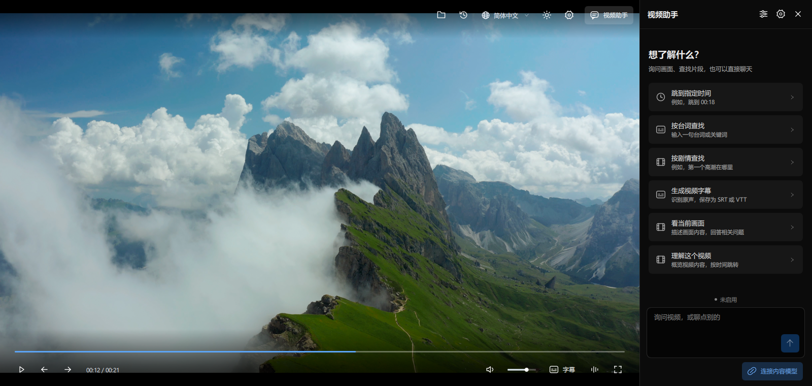
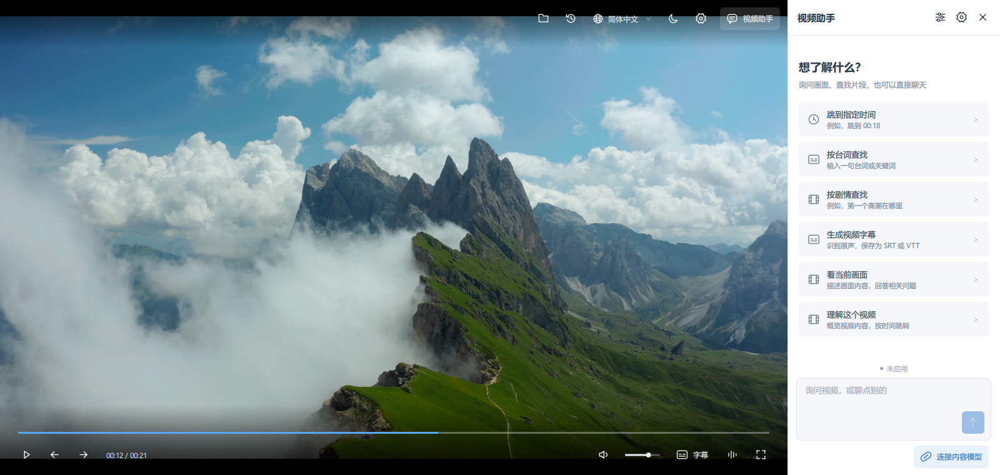

<p align="center">
  
</p>

<h1 align="center">PomiPlayer</h1>

<p align="center">Windows 视频播放器，内置可选的视频助手。</p>

<p align="center">
  <a href="https://github.com/Pumnn1ayLee/PomiPlayer/releases">版本发布</a>　
  <a href="docs/USAGE.md">使用指南</a>　
  <a href="https://github.com/Pumnn1ayLee/PomiPlayer/issues/new/choose">报告问题</a>　
  <a href="README.en.md">English</a>
</p>



PomiPlayer 把主要空间留给视频。播放控制按需出现，视频助手可以随时收起；浅色采用克制的蓝白配色，深色采用近黑背景。

你可以直接观看本地视频，也可以打开助手，查台词、找片段、生成字幕，或继续问一个与视频无关的问题。

## 当前状态

**0.1.0 预览版，首个公开版本准备中。** 目前暂无公开可下载的安装包。第三方分发材料核对完成后，安装包和 SHA-256 校验文件会在 [Releases](https://github.com/Pumnn1ayLee/PomiPlayer/releases) 提供。

这是产品发布与反馈仓库，提供使用说明、界面截图和问题追踪，**不包含 PomiPlayer 核心源码，也不是开源项目**。权利说明见 [NOTICE](NOTICE.md)，第三方组件另按各自许可证处理。

## 可以做什么

| 功能 | 使用体验 |
| --- | --- |
| 日常播放 | 打开或拖入本地视频，调整倍速、音轨、字幕与画面比例，支持全屏、逐帧和片尾重播。 |
| 自然语言查找 | 输入时间直接跳转，按台词关键词找片段；接入模型后，可以围绕视频内容提问。 |
| 视频内容问答 | 根据可用字幕或授权的采样画面回答问题。视频概览按时间整理关键片段，提供可点击的时间按钮。 |
| 生成字幕 | 在助手中发起转写，选择 SRT 或 VTT，以及默认或自定义保存位置；生成后自动加载。需要自行准备语音模型。 |
| 可选模型服务 | 配置自己的云端服务，或在准备本地运行库与模型后使用本地推理。普通播放不需要模型或服务账号。 |
| 界面与操作 | 深浅主题、可自定义快捷键、精简右键菜单，以及九种可即时切换的界面语言。 |

### 试着这样问

```text
跳到 00:18
找到「信号」的片段
当前画面里有什么？
概括这个视频，按时间列出关键片段
为这个视频生成 SRT 字幕
解释一下光合作用
```

时间和播放控制指令不需要 AI 模型。台词关键词检索需要可用字幕；内容问答需要相应模型服务；字幕转写需要语音模型。

回答默认使用当前界面语言，也可以明确要求其他语言。能否理解画面，取决于所选模型是否支持图片以及是否授权发送采样画面。

## 安装与使用

首个公开安装包发布后：

1. 从 [Releases](https://github.com/Pumnn1ayLee/PomiPlayer/releases) 下载 Windows x64 安装包及对应校验文件。
2. 选择有写入权限的安装目录，例如 `D:\Apps\PomiPlayer`。不需要管理员权限，设置与缓存保存在播放器目录内。
3. 打开视频即可播放。需要内容问答时，再从设置中连接模型服务；生成字幕时按提示选择语音模型。

标准安装包不包含模型权重、云服务账号或 API 密钥。GPU 本地推理所需组件不在标准包中，请以各版本发布说明为准。卸载保留个人设置、缓存和自行添加的模型。

当前验证平台为 **Windows 11 x64**。本地 AI 的内存和显存需求由模型、上下文及图像预算决定；不要求为普通播放加载本地模型。其他系统版本和 ARM64 尚未列入当前验证范围。

完整操作见 [使用指南](docs/USAGE.md)。

## 两种主题，同一套操作



支持简体中文、繁体中文、English、日本語、한국어、Français、Deutsch、Español 和 Português (Brasil)。在首页右上角或设置中切换，无需重启。

截图来自 PomiPlayer 实际播放窗口。演示视频由 [Zlatin Georgiev](https://www.pexels.com/video/breathtaking-view-of-the-dolomite-mountains-italy-15708456/) 拍摄，来自 Pexels；素材来源、许可与截图说明见 [演示素材](docs/MEDIA_CREDITS.md)。

## 数据与使用边界

- 普通播放、时间跳转和字幕关键词检索可离线使用。
- 使用云端助手时，问题及回答所需的相关字幕会发送给你配置的服务。发送采样画面需要单独授权；连接服务不等于授权上传视频画面。
- 云服务密钥随服务设置由 Windows DPAPI 保护。设置、播放记录、字幕和索引不随本仓库公开。
- 视频理解基于采样与检索，可能遗漏短暂事件或误解画面。时间按钮用于查看对应依据，不能等同于逐帧完整理解。
- 语音转写的准确率与速度取决于音轨、语言、模型和硬件。请遵守视频内容及模型的使用许可。

## 反馈

遇到问题，请通过 [问题模板](https://github.com/Pumnn1ayLee/PomiPlayer/issues/new/choose) 提供版本、复现步骤和必要的环境信息。提交前请删除 API 密钥、私人路径及敏感字幕；无需上传完整私人视频。

功能建议同样欢迎通过 Issues 提交。安全问题请使用 [私密漏洞报告](https://github.com/Pumnn1ayLee/PomiPlayer/security/advisories/new)，具体说明见 [SECURITY](SECURITY.md)。

## 第三方组件与权利

PomiPlayer 使用 Qt、libmpv、FFmpeg、whisper.cpp 等组件，感谢这些项目的维护者。自有代码与第三方组件的许可范围分别说明，详见 [第三方组件](docs/THIRD_PARTY.md) 和 [权利说明](NOTICE.md)。

公开可见不代表授予 PomiPlayer 自有代码、品牌或文档的开源许可；第三方组件原有的许可权利不受本仓库的权利说明限制。
